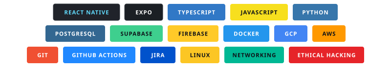

  
  
  
  
  
  
  
  
  

<h1 align="center">¡Hola, soy SasoDev!</h1>

  
   
  

 

  

  <picture>
    <source media="(prefers-color-scheme: dark)" srcset="https://raw.githubusercontent.com/salvaalejos/salvaalejos/output/pacman-contribution-graph-dark.svg" />
    <source media="(prefers-color-scheme: light)" srcset="https://raw.githubusercontent.com/salvaalejos/salvaalejos/output/pacman-contribution-graph.svg" />
    
  </picture>

---

<h2 align="center">Sobre Mí</h2>

<table align="center" width="100%">
  <tr>
    <td width="50%" valign="top">
      <h3>Formación y Experiencia</h3>
      <ul>
        <li><strong>Instituto Tecnológico de Morelia (ITM)</strong> — Ingeniería en Sistemas Computacionales (esp. en Ing. de Software).</li>
        <li><strong>GCI World 2026</strong> — Programa de IA y Ciencia de Datos (Universidad de Tokio).</li>
        <li><strong>Docencia</strong> — Instructor de cursos de Machine Learning.</li>
        <li><strong>Liderazgo</strong> — Representante y líder en el Concejo Estudiantil (<strong>CEITM</strong>).</li>
        <li><strong>Idiomas</strong> — Español (Nativo) · Inglés (B1–B2) · Alemán (A1–A2).</li>
      </ul>
    </td>
    <td width="50%" valign="top">
      <h3>Enfoque e Intereses</h3>
      <ul>
        <li><strong>Mobile y Full-Stack</strong> — Desarrollo de <strong>UniRoomie</strong>, <strong>Caballo de Hierro</strong> y <strong>CEITM-WEB</strong>.</li>
        <li><strong>IA y Ciencia de Datos</strong> — Machine Learning y soluciones basadas en datos.</li>
        <li><strong>Redes y Hacking Ético</strong> — Actualmente aprendiendo redes y ciberseguridad.</li>
        <li><strong>Fuera del código</strong> — Halo (Jefe Maestro), Spider-Man (Peter Parker) y Pokémon.</li>
      </ul>
    </td>
  </tr>
</table>

 

  

---

<h2 align="center">Tecnologías y Herramientas</h2>

  

---

<h2 align="center">Proyectos Destacados</h2>

| Proyecto | Descripción | Stack |
| :--- | :--- | :--- |
| **UniRoomie** | App móvil de vivienda estudiantil para el ITM | `React Native` `Expo` `Supabase` |
| **[Caballo de Hierro (`cdh`)](https://github.com/salvaalejos/cdh)** | Plataforma web y móvil de recolección de encuestas | `Web` `Mobile` `PostgreSQL` |
| **CEITM-WEB** | Plataforma web del Concejo Estudiantil del ITM | `GCP` `AWS` `Web` |

---

<h2 align="center">Conecta Conmigo</h2>

  
   
  
   
  

 

  

 

  
  
  
  
  
  
  

