  
    
  
    
  
    
  

<h1 align="center">Hey, I'm SasoDev!</h1>

  
  

 

  

 

  <picture>
    <source media="(prefers-color-scheme: dark)" srcset="https://raw.githubusercontent.com/salvaalejos/salvaalejos/output/pacman-contribution-graph-dark.svg" />
    <source media="(prefers-color-scheme: light)" srcset="https://raw.githubusercontent.com/salvaalejos/salvaalejos/output/pacman-contribution-graph.svg" />
    
  </picture>

---

<h2 align="center">About Me</h2>

<table align="center" width="100%">
  <tr>
    <td width="50%" valign="top">
      <h3>Education & Experience</h3>
      <ul>
        <li><strong>Instituto Tecnológico de Morelia (ITM)</strong> — Computer Systems Engineering (Software Engineering specialty).</li>
        <li><strong>GCI World 2026</strong> — AI & Data Science program (University of Tokyo).</li>
        <li><strong>Teaching & Leadership</strong> — Machine Learning course instructor & Student Council (<strong>CEITM</strong>).</li>
        <li><strong>Languages</strong> — Spanish (Native) · English (B1–B2) · German (A1–A2).</li>
      </ul>
    </td>
    <td width="50%" valign="top">
      <h3>Focus & Interests</h3>
      <ul>
        <li><strong>Mobile & Full-Stack</strong> — Building apps like <strong>UniRoomie</strong>, <strong>Caballo de Hierro</strong> & <strong>CEITM-WEB</strong>.</li>
        <li><strong>AI & Data Science</strong> — Machine Learning & data-driven solutions.</li>
        <li><strong>Networking & Ethical Hacking</strong> — Currently diving into networks & cybersecurity.</li>
        <li><strong>Off-screen</strong> — Halo (Master Chief), Spider-Man (Peter Parker) & Pokémon.</li>
      </ul>
    </td>
  </tr>
</table>

---

<h2 align="center">Tech Stack & Tools</h2>

  
  
  
  
  
   
  
  
  
  
  
  
   
  
  
  
  

---

<h2 align="center">Featured Projects</h2>

| Project | Description | Stack |
| :--- | :--- | :--- |
| **UniRoomie** | Student housing mobile app for ITM | `React Native` `Expo` `Supabase` |
| **[Caballo de Hierro (`cdh`)](https://github.com/salvaalejos/cdh)** | Web & mobile survey platform for a consulting firm | `Web` `Mobile` `PostgreSQL` |
| **CEITM-WEB** | Official web platform for the ITM Student Council | `GCP` `AWS` `Web` |

---

<h2 align="center">Connect With Me</h2>

  
  <a href="https://www.linkedin.com/in/salvaalejos">
    <img src="https://img.shields.io/badge/LinkedIn-0A66C2?style=for-the-badge&logo=linkedin&logoColor=white" alt="LinkedIn
